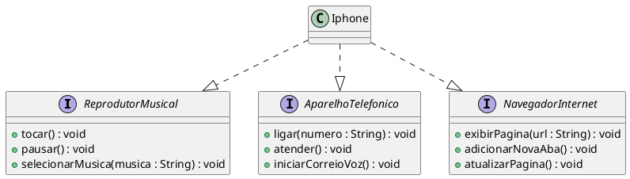

# 📱 Modelagem e Diagramação de um Componente iPhone

Este projeto apresenta a **modelagem UML de um componente iPhone**, representando suas principais funcionalidades por meio de interfaces e implementação em Java.

O iPhone é modelado como uma classe que implementa três diferentes funcionalidades:

* 🎵 **Reprodutor Musical**
* 📞 **Aparelho Telefônico**
* 🌐 **Navegador na Internet**

---

## 📌 Funcionalidades Modeladas

### 🎵 Reprodutor Musical

Responsável pelas funcionalidades relacionadas à reprodução de músicas.

* `tocar()`
* `pausar()`
* `selecionarMusica(musica: String)`

### 📞 Aparelho Telefônico

Responsável pelas funcionalidades relacionadas às chamadas telefônicas.

* `ligar(numero: String)`
* `atender()`
* `iniciarCorreioVoz()`

### 🌐 Navegador na Internet

Responsável pelas funcionalidades relacionadas à navegação na internet.

* `exibirPagina(url: String)`
* `adicionarNovaAba()`
* `atualizarPagina()`

---

## 📐 Diagrama de Classes UML



### Representação

O diagrama demonstra que a classe `Iphone` implementa as três interfaces:

```text
                 ┌─────────────────────────┐
                 │   ReprodutorMusical     │
                 ├─────────────────────────┤
                 │ + tocar()               │
                 │ + pausar()              │
                 │ + selecionarMusica()    │
                 └────────────▲────────────┘
                              │
                              │
┌───────────────────────┐     │     ┌─────────────────────────┐
│ AparelhoTelefonico    │     │     │   NavegadorInternet     │
├───────────────────────┤     │     ├─────────────────────────┤
│ + ligar()             │     │     │ + exibirPagina()        │
│ + atender()           │     │     │ + adicionarNovaAba()    │
│ + iniciarCorreioVoz() │     │     │ + atualizarPagina()     │
└───────────▲───────────┘     │     └────────────▲────────────┘
            │                 │                  │
            └─────────────────┼──────────────────┘
                              │
                     ┌────────┴────────┐
                     │     Iphone      │
                     └─────────────────┘
```

---

## 🛠️ Tecnologias Utilizadas

* **Java** — Implementação das interfaces e da classe `Iphone`.
* **PlantUML** — Modelagem e geração do diagrama UML.
* **IntelliJ IDEA** — Ambiente de desenvolvimento utilizado no projeto.

---

## 📂 Estrutura do Projeto

```text
src/
└── Iphone.java
└── ReprodutorMusical.java
└── AparelhoTelefonico.java
└── NavegadorInternet.java

diagram/
└── Iphone.puml

README.md
```

---

## 🚀 Como Visualizar o Diagrama

### 1. Instale o suporte ao PlantUML

Instale o plugin **PlantUML Integration** na sua IDE, como:

* IntelliJ IDEA
* Visual Studio Code

### 2. Abra o arquivo `.puml`

Localize o arquivo do diagrama, por exemplo:

```text
Iphone.puml
```

### 3. Visualize o diagrama

Abra a visualização do PlantUML para gerar a representação gráfica das interfaces e da classe `Iphone`.

---

## 🎯 Objetivo do Projeto

O objetivo deste projeto é praticar conceitos fundamentais de **Programação Orientada a Objetos**, especialmente:

* Interfaces
* Implementação de interfaces
* Abstração
* Diagramação UML
* Organização de responsabilidades
* Modelagem de funcionalidades de um sistema

O projeto utiliza o conceito de interfaces para representar diferentes comportamentos que podem ser implementados por um único dispositivo.

---

## 📚 Conceito Aplicado

O `Iphone` atua como uma implementação de diferentes interfaces, permitindo que o mesmo objeto possua responsabilidades distintas:

```java
public class Iphone implements ReprodutorMusical,
                              AparelhoTelefonico,
                              NavegadorInternet {
    // Implementações
}
```

Essa abordagem demonstra como a **composição de comportamentos por meio de interfaces** pode representar diferentes funcionalidades dentro de uma mesma classe.

---

## 👨‍💻 Autor

**DevDan**

Projeto desenvolvido para prática de **Java, Programação Orientada a Objetos e UML**.
